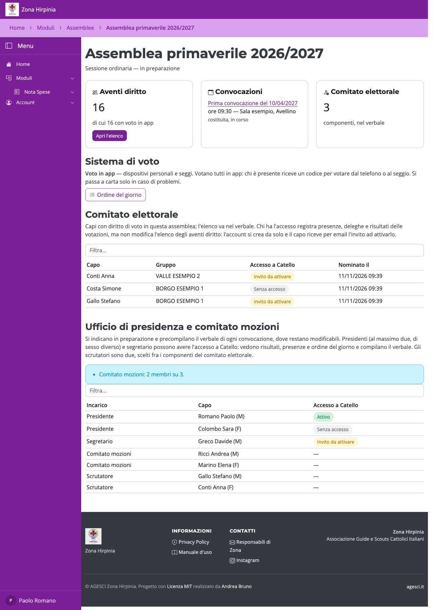

# Comitato elettorale e ufficio di presidenza

Entrambi si indicano dalla pagina dell'assemblea, scegliendo i capi fra gli aventi
diritto con la ricerca.

## Comitato elettorale

I componenti gestiscono il banco e le votazioni il giorno dell'assemblea. Con la casella
**Crea l'account e invia l'invito** spuntata, il capo riceve un account (se non ne ha già
uno) e un'email per attivarlo; senza, compare solo nel verbale. L'accesso si può dare
anche dopo con **Crea account e invia invito**. L'elenco completo va nel verbale.

## Ufficio di presidenza e comitato mozioni

- **Presidenti**: al massimo due, di sesso diverso.
- **Segretario**: uno.
- **Comitato mozioni**: tre membri (si possono raccogliere un po' alla volta).
- **Scrutatori**: due, scelti fra i componenti del comitato elettorale.

Presidenti e segretario possono avere l'accesso: vedono l'assemblea, i risultati e
l'ordine del giorno e compilano il verbale. Tutti questi nomi precompilano il verbale di
ogni convocazione, dove si possono ancora correggere.

