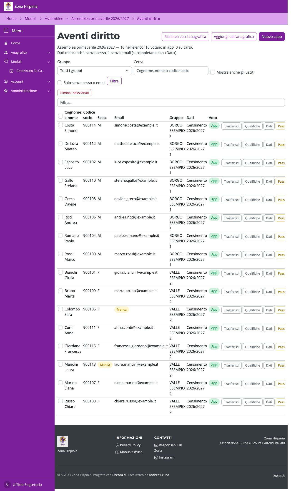
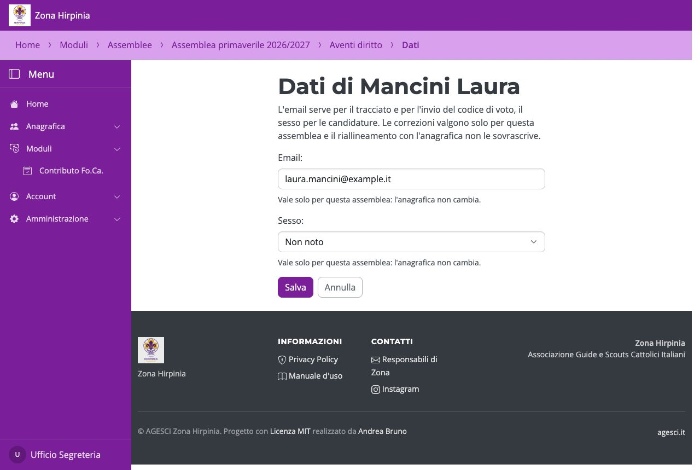
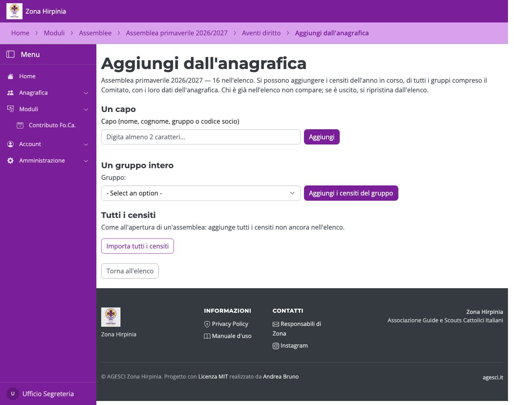
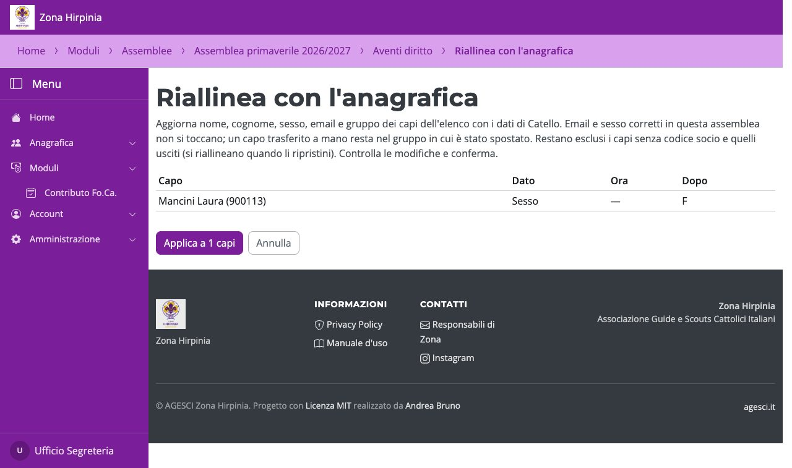

# L'elenco degli aventi diritto

L'elenco è separato dall'anagrafica: le modifiche fatte qui valgono solo per questa
assemblea e non toccano i dati dei capi in Catello.

- **Filtri**: per gruppo, per nome o codice socio, «Mostra anche gli usciti» e **Solo
  senza sesso o email**. Sesso ed email mancanti sono evidenziati con «Manca».
- **Dati**: corregge email e sesso del capo per questa assemblea. Le correzioni restano
  anche dopo un riallineamento.
- **Trasferisci**, **Qualifiche** (AE di Zona, Responsabile di Zona, membro del
  Comitato), **Passa a carta** / **Torna in app**.
- **Elimina i selezionati**: la casella in testa alla colonna seleziona tutti i capi
  visibili; sopra la tabella compare quanti sono selezionati. L'eliminazione è
  reversibile: **Ripristina** riporta il capo nell'elenco aggiornandone i dati
  dall'anagrafica.
- **Nuovo capo**: per chi non è censito, con i dati scritti a mano.

## Aggiungere capi dall'anagrafica

**Aggiungi dall'anagrafica** aggiunge un censito cercandolo per nome, cognome, gruppo o
codice socio, oppure tutti i censiti di un gruppo, oppure tutti i censiti. Si usa per le
assemblee nate con l'elenco vuoto o per chi è stato censito dopo. Chi è uscito non si
reimporta: si ripristina dall'elenco.

## Riallineare con l'anagrafica

**Riallinea con l'anagrafica** mostra in anteprima cosa cambierebbe (nome, cognome,
sesso, email e gruppo del censimento) e lo applica solo dopo la conferma. Email e sesso
corretti in questa assemblea e i trasferimenti fatti a mano non si toccano.

