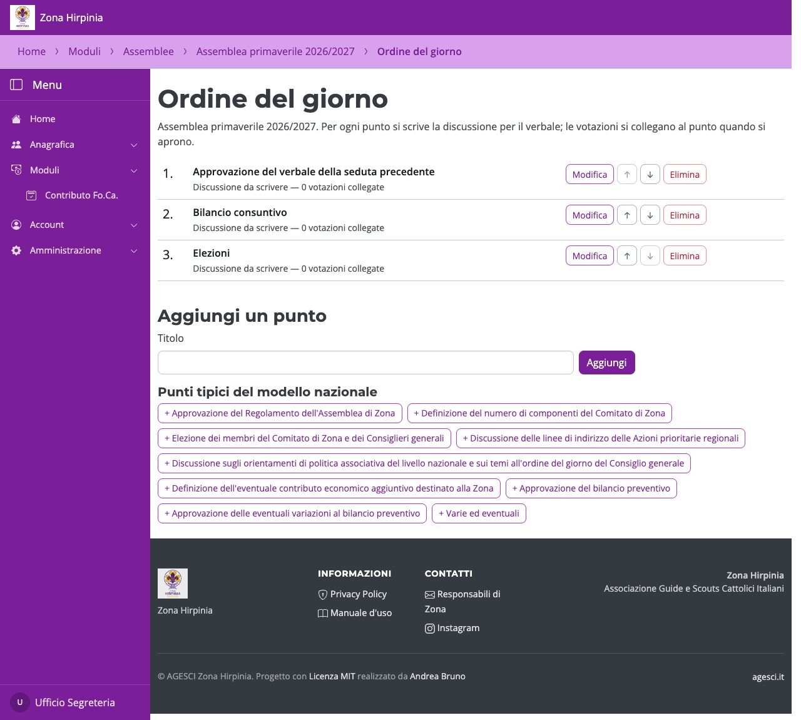
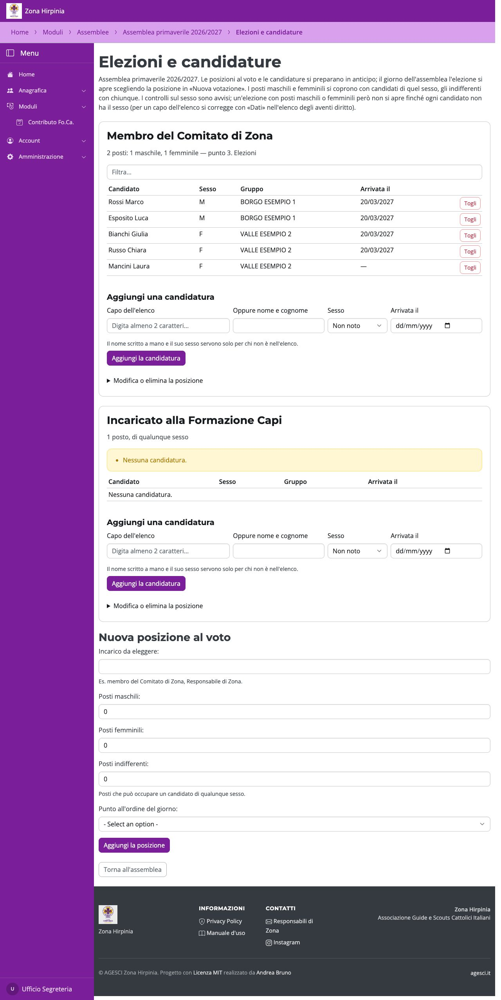

# Ordine del giorno ed elezioni

## Ordine del giorno

**Ordine del giorno** raccoglie i punti, con le proposte del modello nazionale. Per ogni
punto si scrive la discussione per il verbale: la possono scrivere anche presidenti e
segretario, che però non cambiano i punti.

## Elezioni e candidature

**Elezioni e candidature** prepara in anticipo le posizioni al voto:

- **incarico** da eleggere e **posti**: maschili, femminili e indifferenti (per un
  candidato di qualunque sesso);
- il **punto** dell'ordine del giorno a cui appartiene;
- le **candidature** man mano che arrivano: un capo dell'elenco oppure, per chi non c'è,
  un nome scritto con il suo sesso, e la data di arrivo.

Sotto ogni posizione Catello segnala, senza bloccare, cosa non torna: un candidato di
sesso diverso dai posti, un sesso non noto, posti maschili o femminili che le
candidature non coprono. Il sesso di un capo dell'elenco si corregge con **Dati**
nell'elenco degli aventi diritto.

!!! warning "Un solo controllo bloccante"
    Un'elezione con posti maschili o femminili **non si apre** finché ogni candidato
    non ha il sesso.
