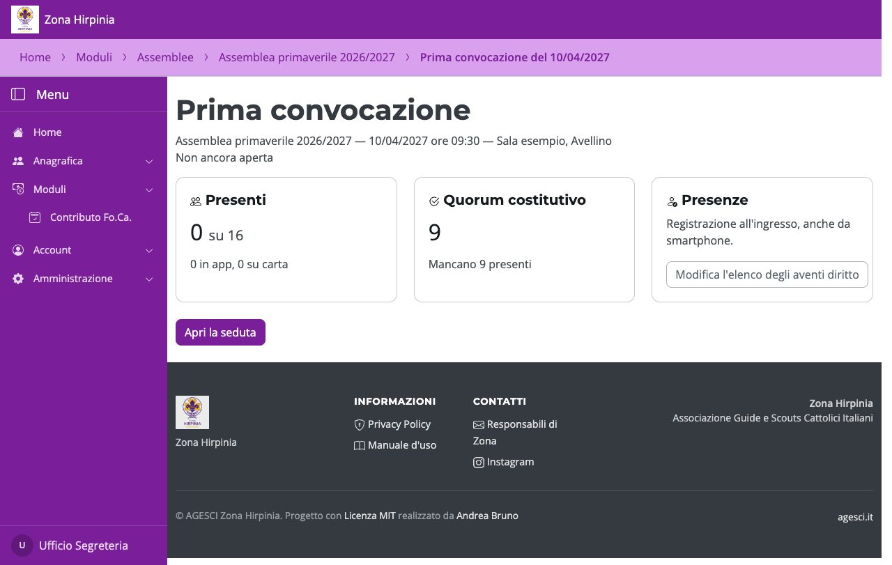
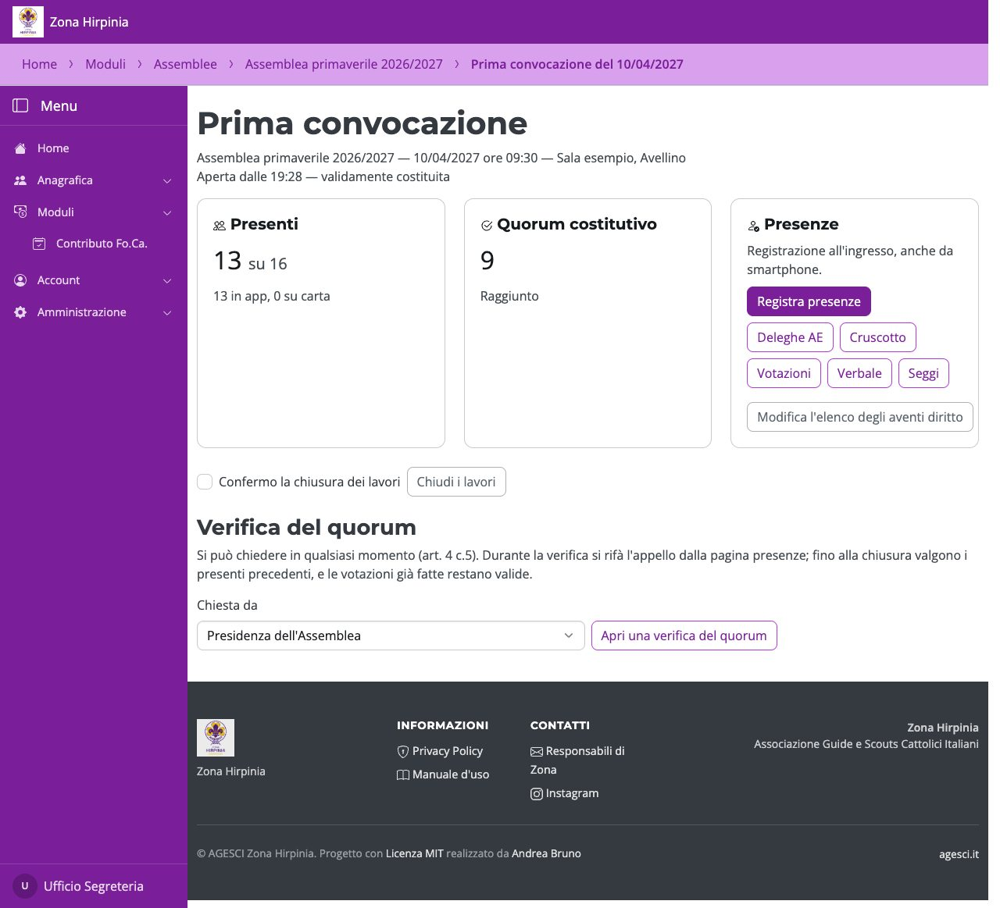
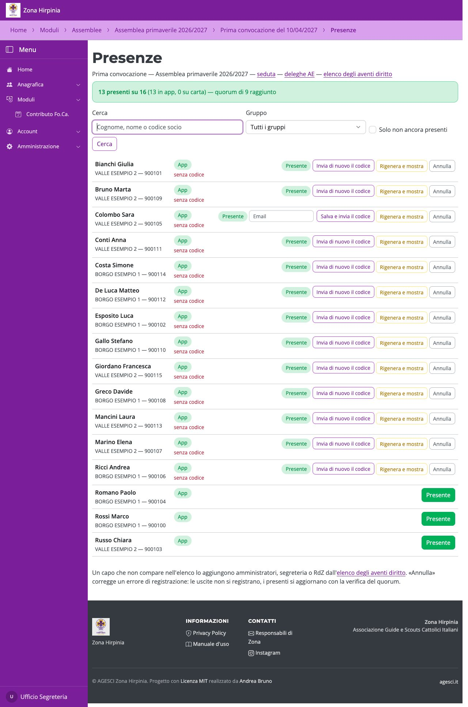
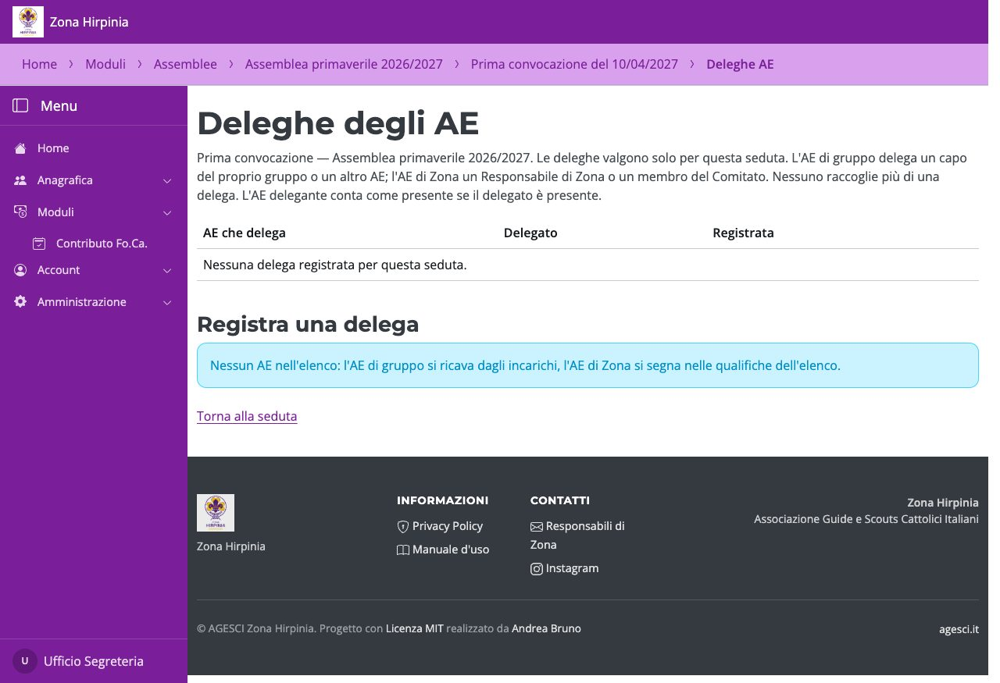
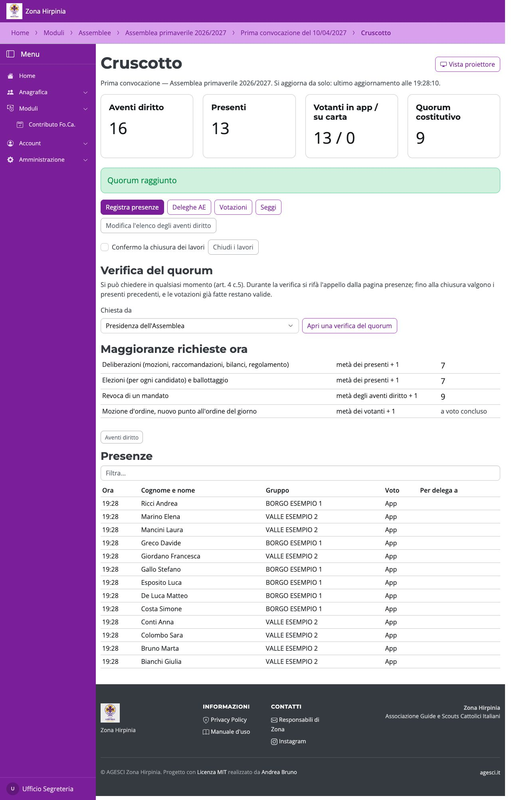
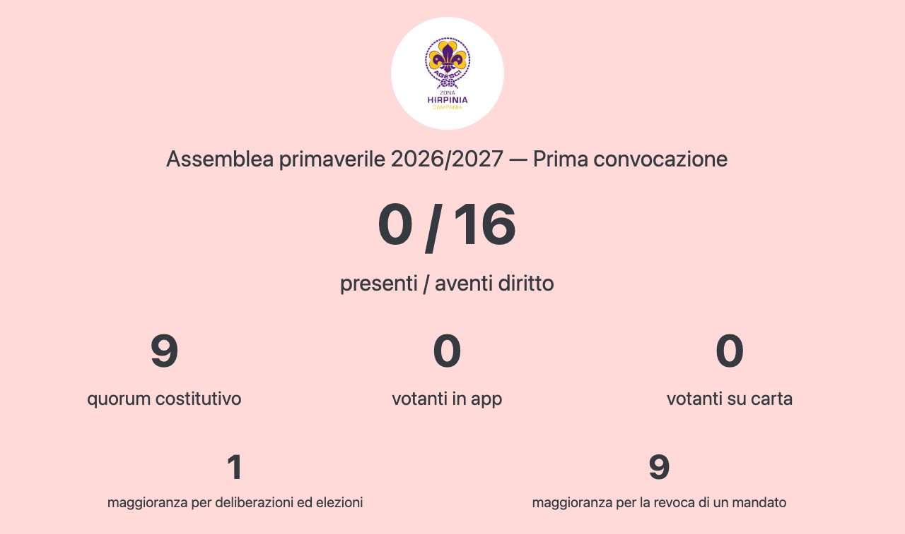
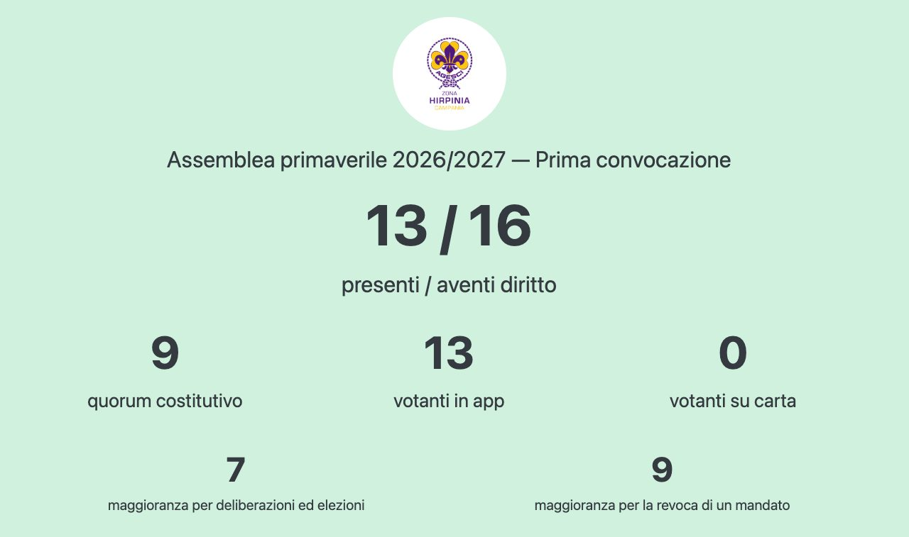
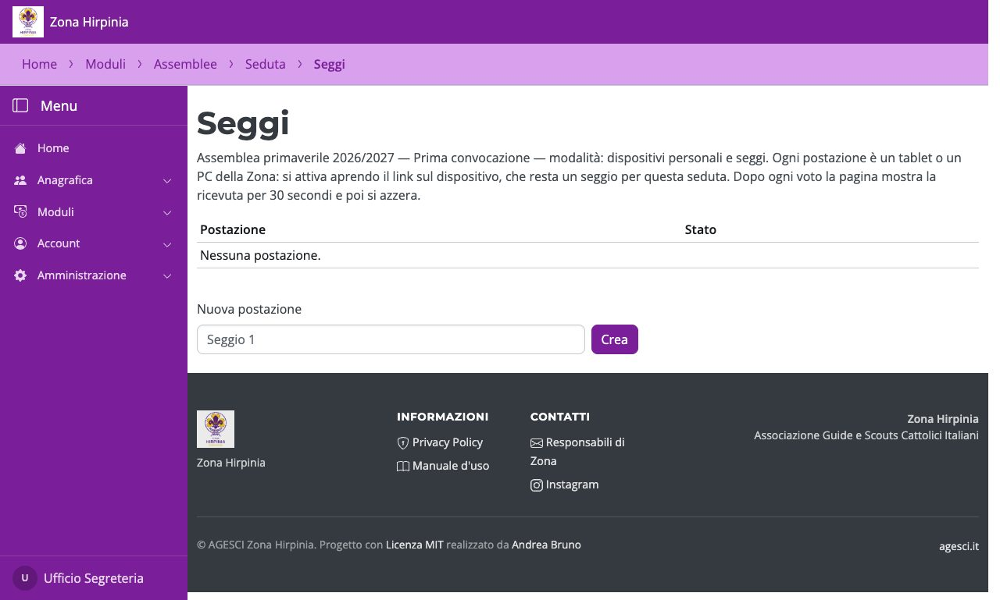

# Il giorno dell'assemblea

## La seduta

Dalla pagina dell'assemblea apri la convocazione. **Apri la seduta** abilita la
registrazione delle presenze. Finché la seduta è aperta, la pagina dell'assemblea e
l'elenco delle assemblee mostrano **Vai alla seduta** per arrivarci subito.

Quando i presenti bastano, **Dichiara validamente costituita**; se il quorum manca,
**Chiudi: quorum non raggiunto** e si passa alla convocazione successiva. A fine lavori,
**Chiudi i lavori**. Una **verifica del quorum** si può aprire in qualsiasi momento: si
rifà l'appello dalla pagina delle presenze.

## Presenze e codici

**Registra presenze**: si cerca il capo e si preme **Presente**. Se un capo non è
nell'elenco, i gestori lo aggiungono da **Modifica l'elenco degli aventi diritto** (nella
seduta) o dal collegamento in cima alla pagina delle presenze. Con il voto in app il
codice di voto parte subito per email; in alternativa **Rigenera e mostra** lo mostra a
schermo, con l'etichetta da stampare. I dettagli sono nel manuale per il banco e i seggi.

## Deleghe degli AE

**Deleghe AE** registra le deleghe della seduta: l'AE di gruppo delega un capo del
proprio gruppo o un altro AE, l'AE di Zona un Responsabile di Zona o un membro del
Comitato; nessuno raccoglie più di una delega. Quando il delegato viene registrato presente, nella
pagina delle presenze l'AE che ha delegato compare come **Presente per delega** e conta
per il quorum; se arriva di persona si può segnare con **Presente di persona** (conta
comunque una volta sola).

## Cruscotto e seggi

Il **Cruscotto** si aggiorna da solo: presenti, quorum, maggioranze richieste. Appena il
quorum è raggiunto compare **Dichiara validamente costituita**, come nella pagina della
seduta. La
**Vista proiettore** è la versione da mostrare in sala, senza dati personali.

La vista proiettore ha lo sfondo **rosso tenue** finché manca il quorum e **verde tenue**
quando è raggiunto.

**Seggi** crea le postazioni di voto in sala (tablet o PC della Zona).

