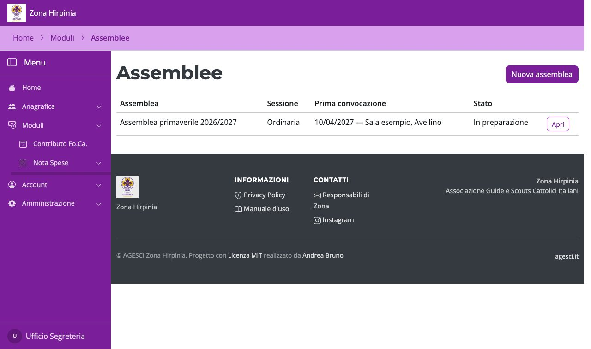
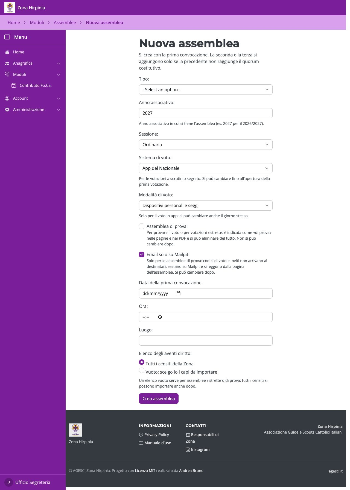
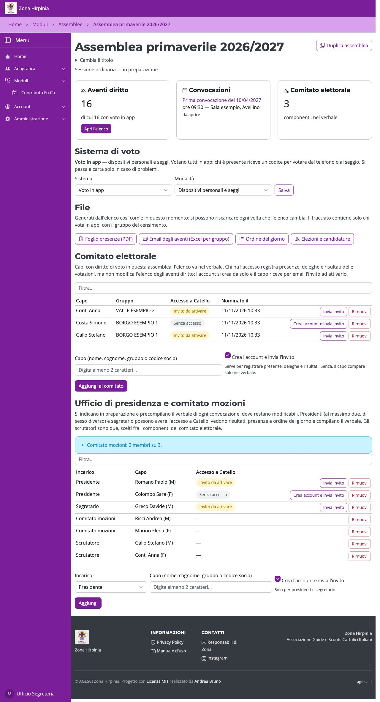
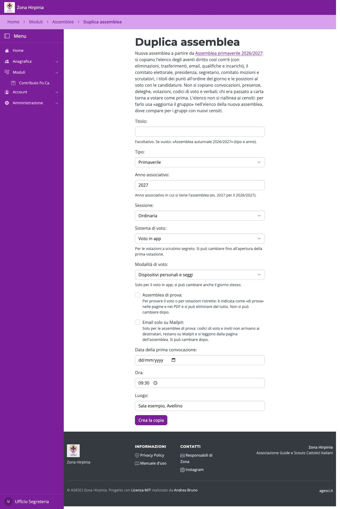

# Creare e preparare l'assemblea

## Nuova assemblea

Da **Assemblee** premi **Nuova assemblea**.

Si indicano un **titolo** facoltativo (se vuoto il nome è «Assemblea autunnale 2026/2027»,
da tipo e anno; si può cambiare dopo con **Cambia il titolo** nella pagina
dell'assemblea), tipo (autunnale o primaverile), anno associativo, sessione e la **prima
convocazione** (data, ora, luogo). Le convocazioni successive si aggiungono solo se la
precedente non raggiunge il quorum.

- **Sistema di voto**: *Voto in app* (con la piattaforma: votano tutti in app, la carta solo per chi
  ha problemi) oppure *App del Nazionale* (tracciato da caricare nell'app nazionale,
  risultati copiati a mano). Si può cambiare fino all'apertura della prima votazione.
- **Modalità** (solo voto in app): dispositivi personali e seggi, oppure solo seggi. Si
  cambia anche il giorno stesso.
- **Elenco degli aventi diritto**: *tutti i censiti della Zona* oppure *vuoto*, per
  assemblee ristrette o di prova, scegliendo poi i capi da importare.
- **Assemblea di prova**: si sceglie solo qui e non si cambia dopo. È indicata come «di
  prova» ovunque, anche nei PDF, ed è l'unica che si può eliminare. Con **Email solo su
  Mailpit** codici e inviti non arrivano ai destinatari: si leggono dalla pagina
  dell'assemblea.

## La pagina dell'assemblea

È il punto di partenza per tutto: aventi diritto, convocazioni, sistema di voto, file,
comitato elettorale, ufficio di presidenza, ordine del giorno ed elezioni.

## Duplicare un'assemblea

**Duplica assemblea** crea una nuova assemblea a partire da questa: copia l'elenco così
com'è (con eliminazioni, trasferimenti, email e qualifiche), comitato elettorale,
ufficio di presidenza, comitato mozioni, titoli dell'ordine del giorno, posizioni al voto
e candidature. Non copia convocazioni, presenze, votazioni, codici e verbali.

