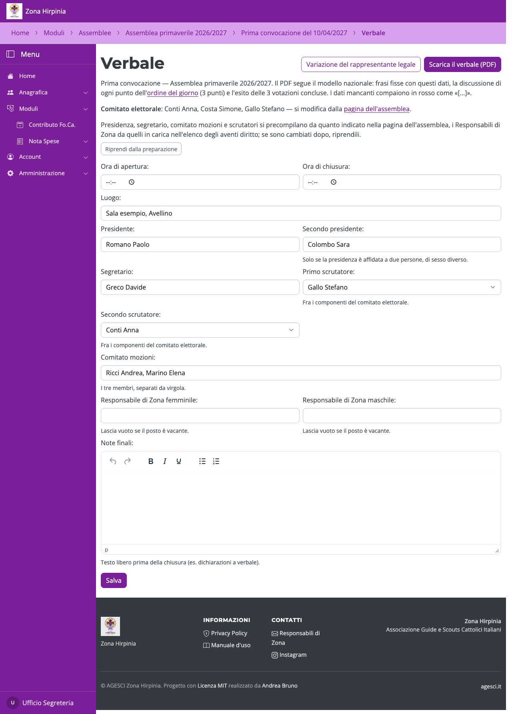

# Verbali e file

## Il verbale

Dalla seduta costituita, **Verbale**: si completano orari, luogo, presidenza, segretario,
scrutatori, comitato mozioni, Responsabili di Zona firmatari (la Responsabile e il
Responsabile, uno dei due posti può essere vacante) e note. I nomi indicati in
preparazione sono già compilati, e i Responsabili di Zona sono quelli in carica secondo
l'elenco degli aventi diritto; se ce ne sono due dello stesso sesso, o il sesso non è
indicato, quel posto resta da scrivere. In ogni campo si può scegliere fra tutti gli aventi
diritto. **Riprendi dalla preparazione** li riporta se nel frattempo sono cambiati. Le
**note finali** si scrivono con un piccolo editor (grassetto, corsivo, sottolineato,
elenchi), senza immagini. **Scarica il verbale (PDF)** genera il verbale sul modello
nazionale, sulla carta intestata della Zona; i dati mancanti compaiono in rosso come
«[…]».

La **variazione del rappresentante legale** (se si elegge un Responsabile di Zona) la
compilano solo i gestori: contiene i dati anagrafici del Responsabile. Il Responsabile si
sceglie fra tutti gli aventi diritto, con in cima gli eletti della seduta (accanto c'è
l'incarico) e poi i Responsabili di Zona già in carica; **Precompila dall'anagrafica**
copia i suoi dati, da controllare e completare con la provincia di nascita.

## I file

Dalla pagina dell'assemblea:

- **Foglio presenze (PDF)**, sulla carta intestata, con l'email di ogni avente
  da controllare all'ingresso;
- **Email degli aventi (Excel per gruppo)**, da far verificare ai capigruppo e
  reimportare;
- **Tracciato per l'app di voto**, solo con l'app del Nazionale.

## Assemblee di prova

Un'assemblea di prova si elimina del tutto con **Elimina assemblea** (gli account creati
per i comitati restano). Con **Email solo su Mailpit**, **Leggi le email** mostra le
email partite per quell'assemblea; nei testi degli inviti il codice di attivazione è
nascosto.
