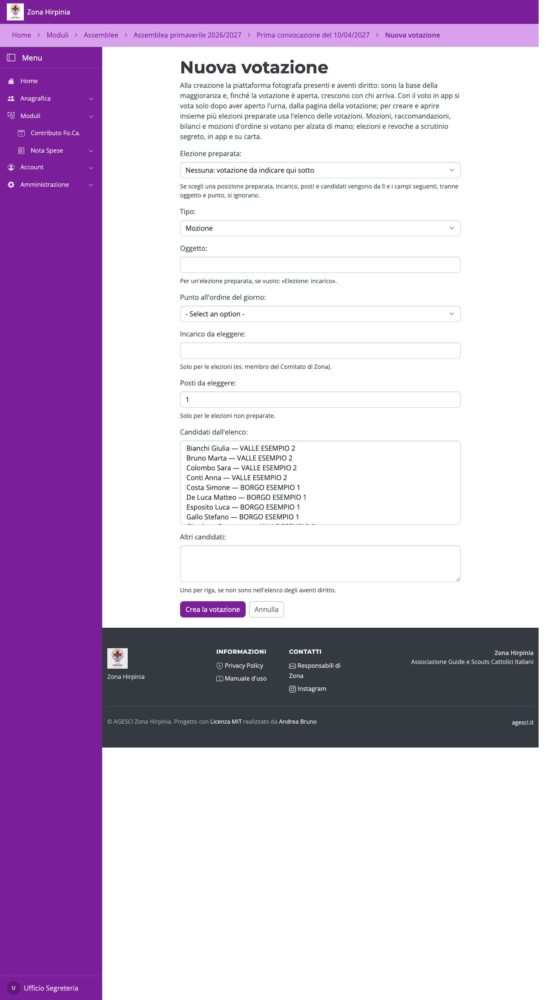
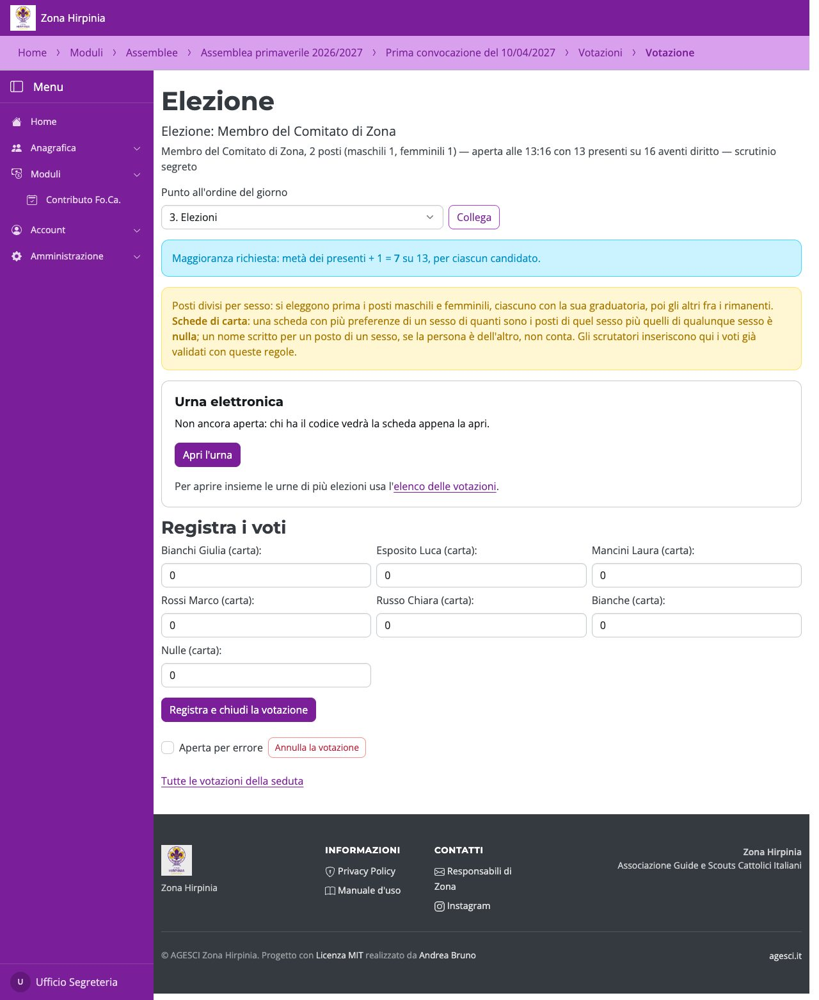
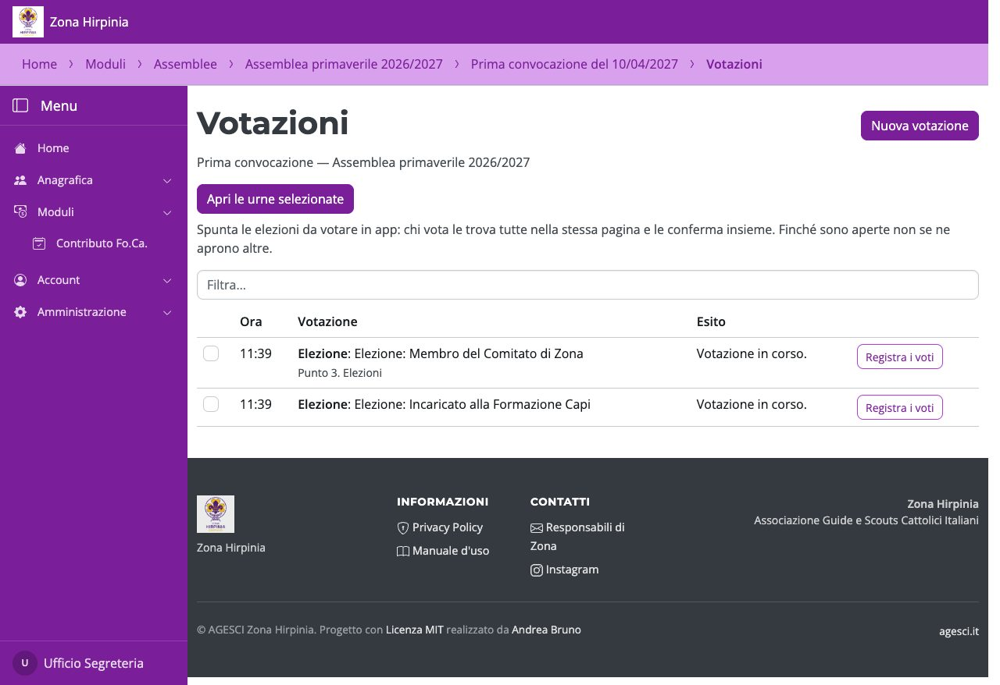
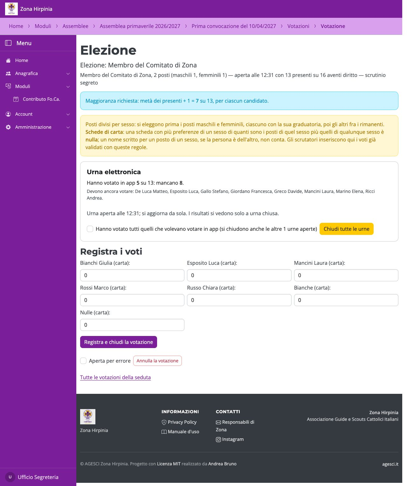
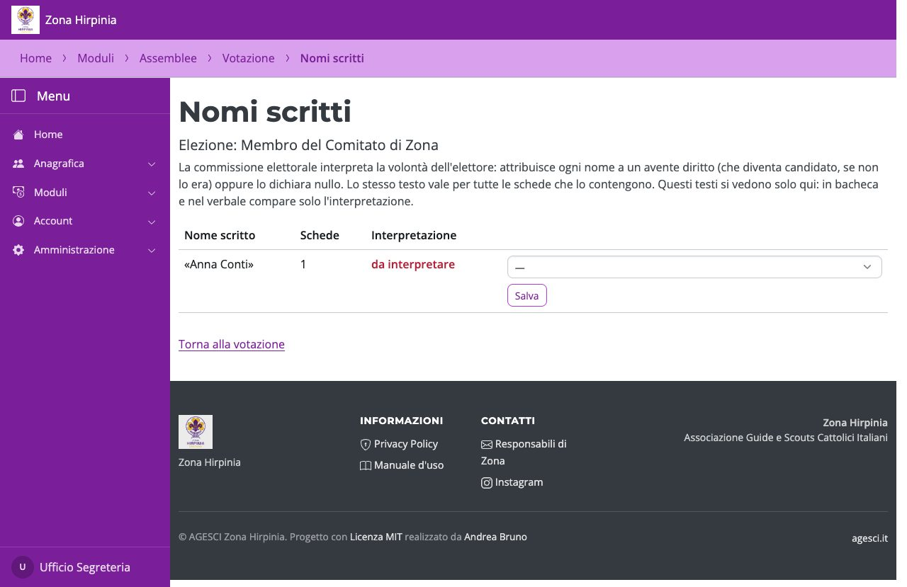
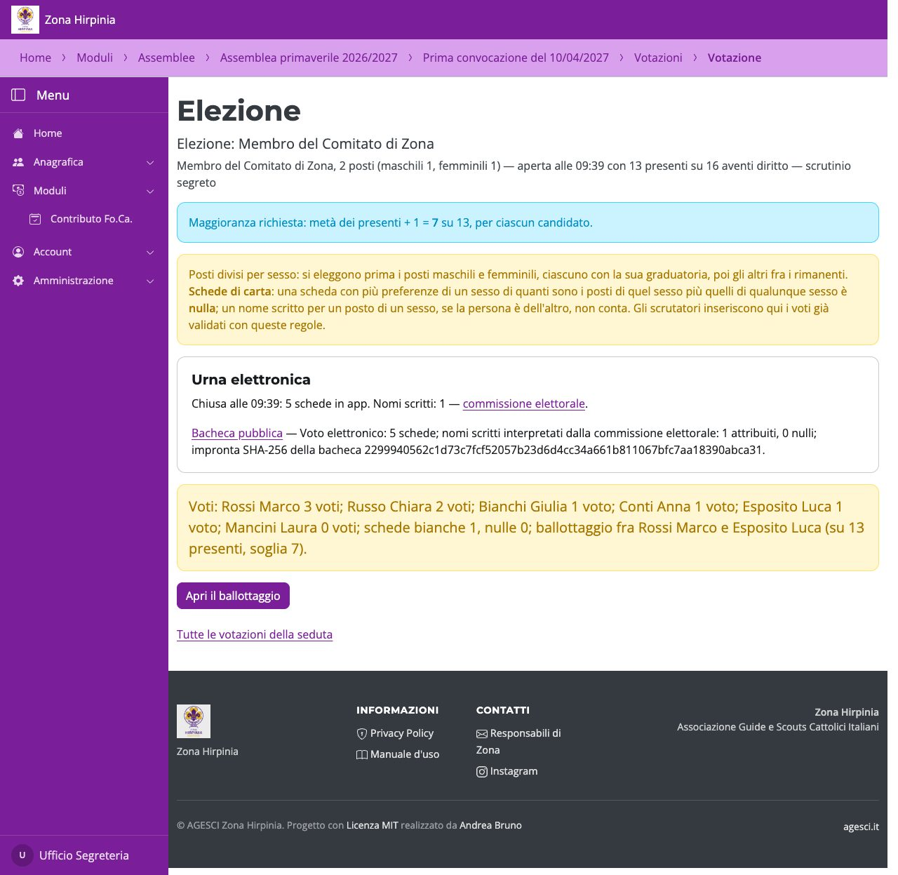

# Votazioni e risultati

## Aprire una votazione

Da **Votazioni** premi **Nuova votazione**. Per un'elezione preparata scegli la posizione
in **Elezione preparata**: incarico, posti, quote e candidati arrivano da lì. Le altre
votazioni (mozioni, bilanci, mozioni d'ordine…) si indicano con tipo e oggetto. All'apertura
la piattaforma fotografa presenti e aventi diritto: sono la base della maggioranza. Chi
arriva mentre la votazione è aperta vota e si aggiunge ai presenti di quella votazione;
finché ci sono votazioni aperte, invece, non si può togliere una presenza né revocare una
delega.

Le **elezioni preparate** si possono anche creare insieme: nell'elenco delle
**Votazioni**, in «Elezioni preparate», spunta le posizioni e premi **Crea le elezioni
selezionate**; con il voto in app, lasciando spuntato **e apri subito le urne** si aprono
anche le urne, tutte insieme.

## L'urna elettronica

Con il voto in app, **Apri l'urna** dalla pagina della votazione: chi ha il codice vede
la scheda. Durante il voto non si vedono risultati: la pagina della votazione e il
**Cruscotto** mostrano, aggiornati da soli, quanti hanno votato in app, quanti mancano e
chi deve ancora votare (chi ha votato è pubblico per regolamento, cosa ha votato no). Sul
proiettore compaiono solo i numeri.

Per votare **più elezioni insieme**, nell'elenco delle **Votazioni** spunta le elezioni e
premi **Apri le urne selezionate**: chi vota le trova tutte nella stessa pagina e le
conferma insieme. Finché ci sono urne aperte non se ne aprono altre: vanno aperte tutte
nello stesso momento.

Quando hanno votato tutti quelli che volevano votare in app, spunta la conferma e **Chiudi
l'urna** (o **Chiudi tutte le urne**, se ce n'è più d'una aperta: si chiudono insieme).

## Nomi scritti

Se nelle schede ci sono nomi scritti, la **commissione elettorale** li attribuisce a un
avente diritto (che diventa candidato) oppure li dichiara nulli. Finché resta un nome da
interpretare, i risultati non si registrano. Con le quote per sesso, un nome si
attribuisce solo a un capo di cui è noto il sesso; se il sesso dichiarato sulla scheda è
diverso, quella preferenza non conta.

## Registrare i risultati

In **Registra i voti** si inseriscono solo i voti **su carta** (e schede bianche e nulle):
quelli in app si contano da soli. **Registra e chiudi la votazione** calcola l'esito,
pubblica la bacheca e ne fissa l'impronta per il verbale.

Con posti maschili e femminili si eleggono prima i posti di ciascun sesso, ognuno con la
sua graduatoria, poi quelli indifferenti fra i rimanenti. Su carta, una scheda con più
preferenze di un sesso di quante ne ammettono i posti è nulla. Se un posto resta
vacante, **Apri il ballottaggio** lo propone fra i due non eletti più votati (dello stesso
sesso del posto, se riservato).
