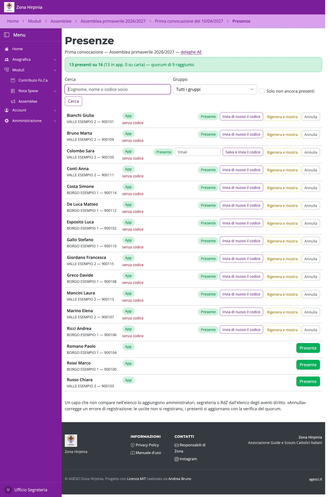
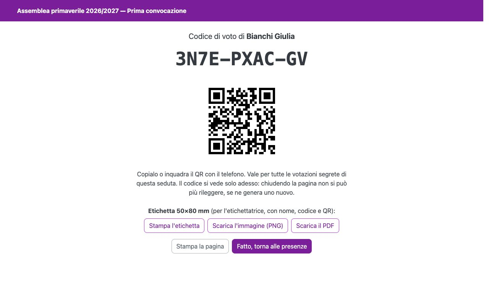
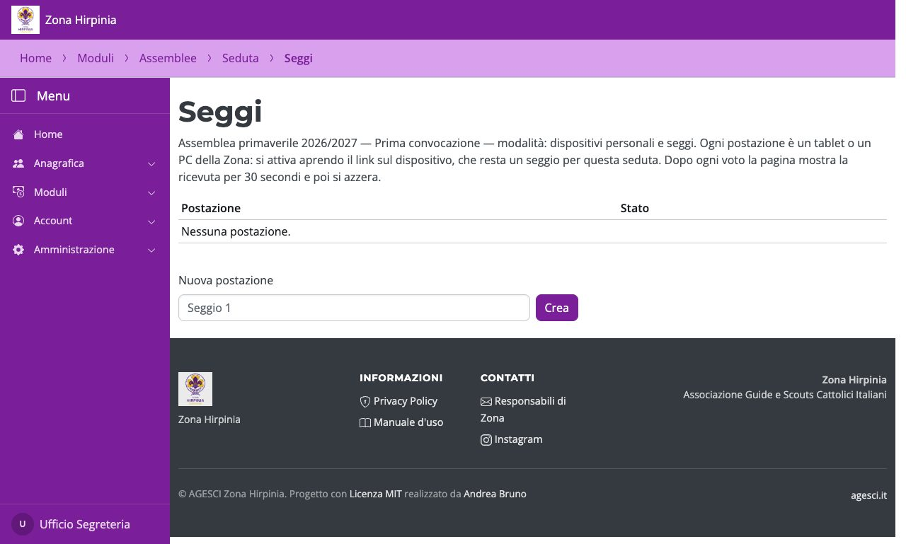

# Per il banco e i seggi

Questa parte è per il **comitato elettorale** e per chi gestisce l'assemblea.

## Registrare le presenze e dare i codici

Dalla pagina della seduta apri **Registra presenze**. Cerca il capo e premi **Presente**:
se ha un'email, il codice gli arriva subito.

Accanto a ogni presente:

- **Invia di nuovo il codice** / **Salva e invia il codice**: corregge o inserisce l'email
  e rimanda il codice (il precedente non vale più);
- **Rigenera e mostra**: genera un codice nuovo e lo mostra a schermo una volta sola.

Nella pagina del codice ci sono anche l'**etichetta 50×80 mm** per l'etichettatrice:

- **Stampa l'etichetta**: stampa direttamente l'etichetta (con l'etichettatrice collegata
  al computer come stampante);
- **Scarica l'immagine (PNG)** o **Scarica il PDF**: per stamparla dall'app
  dell'etichettatrice sul telefono.

!!! warning "Il codice si vede una volta sola"
    Chiusa la pagina non si può più rileggere: se serve, si rigenera. Non fotografarlo e
    non lasciarlo sullo schermo.

## Passare un capo a carta

Nell'elenco degli aventi diritto, **Passa a carta** sposta un capo al voto su carta
(il suo codice si revoca); **Torna in app** lo riporta in app. Si usa solo se ci sono
problemi: di norma votano tutti in app.

## I seggi

Dalla seduta apri **Seggi**: crea una **Nuova postazione** e apri il link di attivazione
sul tablet o PC del seggio (o inquadrane il QR). Il link vale una volta sola. Una
postazione si può **disattivare** in qualsiasi momento.

