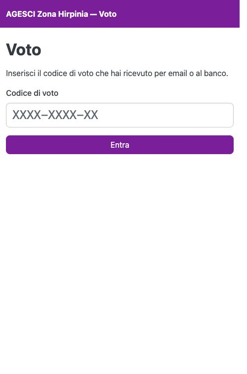

# Entrare al seggio

In sala ci sono dei **seggi**: tablet o PC della Zona già pronti sulla pagina del voto.

1. Scrivi il tuo codice nel campo **Codice di voto** e premi **Entra**. Maiuscole,
   minuscole e trattini non contano.
2. Se la votazione è aperta compare la scheda; altrimenti la pagina resta in attesa e si
   aggiorna da sola.

{ width="320" }

!!! warning "Dopo il voto"
    La ricevuta resta a schermo **30 secondi**, poi la pagina si azzera per il prossimo
    votante: annotala subito. Quando hai finito premi **Fatto, avanti il prossimo**, in
    cima o in fondo alla pagina, senza aspettare. Il codice resta tuo e vale anche per le votazioni
    successive della seduta.
