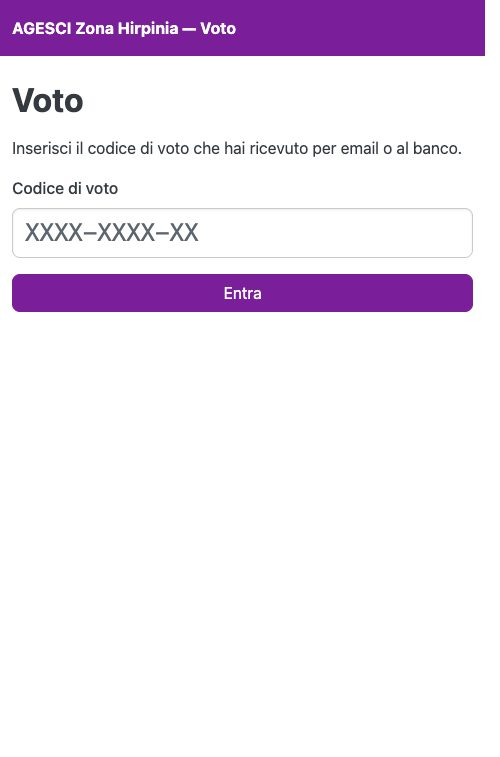
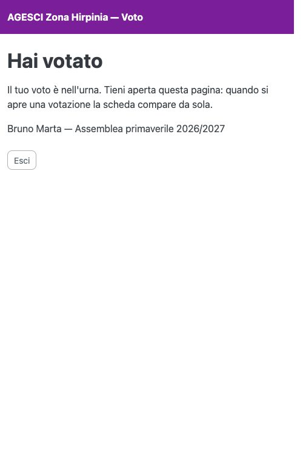

# Entrare dal telefono

Apri il link dell'email (o inquadra il QR dell'etichetta): la pagina del voto si apre con
il codice già inserito. In alternativa apri la pagina del voto e scrivi il codice nel
campo **Codice di voto**, poi premi **Entra**. Maiuscole, minuscole e trattini non
contano.

{ width="320" }

Finché non c'è una votazione aperta, la pagina resta **in attesa** e si aggiorna da sola:
tienila aperta.

{ width="320" }

In alcune assemblee si vota **solo ai seggi**: in quel caso il codice non funziona dal
telefono e la pagina te lo dice.
