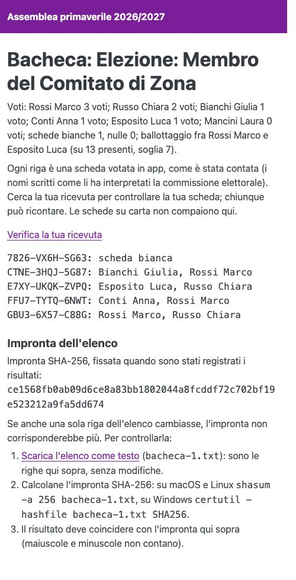
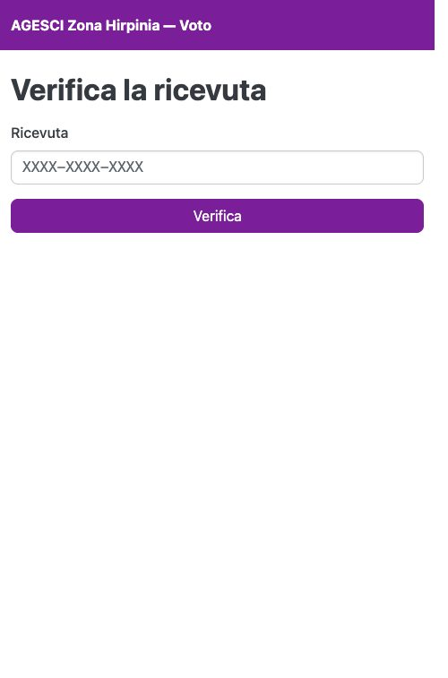

# Controllare il proprio voto

Quando i risultati sono registrati, la **bacheca** della votazione è pubblica: una riga
per ogni scheda votata in app, con la ricevuta e come è stata contata. I nomi scritti
compaiono come li ha interpretati la commissione elettorale, mai il testo originale.
Chiunque può ricontare.

{ width="320" }

Per trovare la tua scheda apri **Verifica la ricevuta** (dal link nella ricevuta o in
bacheca) e scrivi la ricevuta:

- a urna aperta ti dice solo che la scheda è nell'urna;
- a risultati registrati ti mostra la riga della tua scheda come è stata contata.

{ width="320" }

In fondo alla bacheca c'è l'**impronta** SHA-256 dell'elenco, fissata quando sono stati
registrati i risultati: se qualcuno cambiasse anche una sola riga, l'impronta non
corrisponderebbe più. Per controllarla, scarica l'elenco con **Scarica l'elenco come
testo** e calcolane l'impronta: su macOS e Linux `shasum -a 256 bacheca-N.txt`, su
Windows `certutil -hashfile bacheca-N.txt SHA256` (N è il numero nel nome del file). Il
risultato deve coincidere con quello della bacheca; maiuscole e minuscole non contano.
