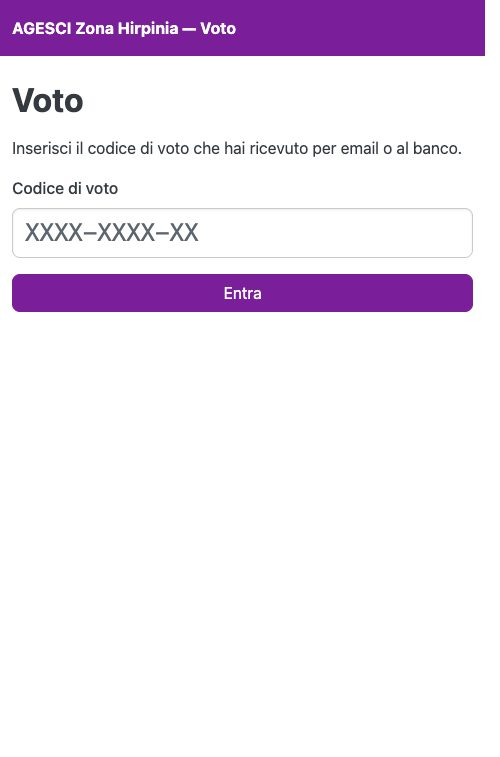
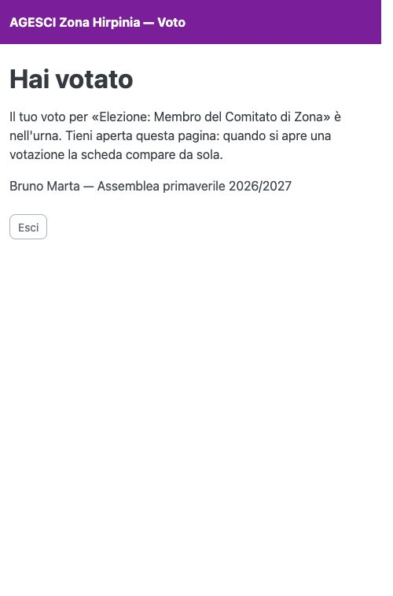
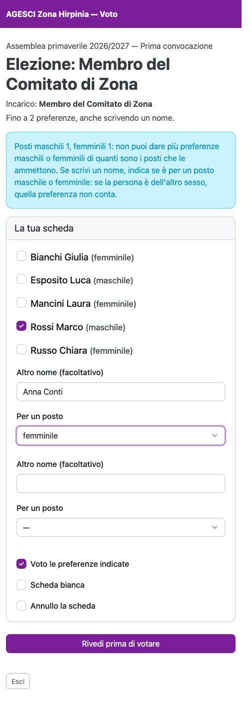
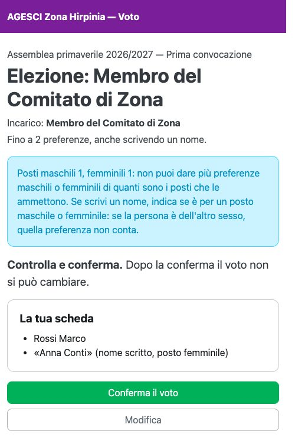
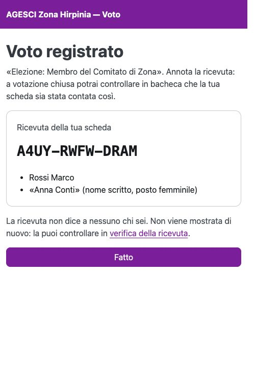

# Votare dal telefono

## Entrare

Apri il link dell'email (o inquadra il QR dell'etichetta): la pagina del voto si apre con
il codice già inserito. In alternativa apri la pagina del voto e scrivi il codice nel
campo **Codice di voto**, poi premi **Entra**. Maiuscole, minuscole e trattini non
contano.

{ width="320" }

Finché non c'è una votazione aperta, la pagina resta **in attesa** e si aggiorna da sola:
tienila aperta.

{ width="320" }

## Compilare la scheda

Quando la presidenza apre l'urna, compare la scheda. In alto ci sono l'incarico da
eleggere e quante preferenze puoi dare.

- **Spunta** i candidati che vuoi votare, fino al numero di preferenze indicato.
- Puoi anche **scrivere un nome** nei campi «Altro nome»: un capo che non è fra i
  candidati. Sarà la commissione elettorale a ricondurlo alla persona.
- In fondo scegli fra **Voto le preferenze indicate**, **Scheda bianca** e **Annullo la
  scheda**.

{ width="320" }

### Posti maschili e femminili

Alcune elezioni hanno posti riservati a un sesso (per esempio un posto maschile e uno
femminile). In quel caso la scheda lo dice nel riquadro azzurro e accanto a ogni
candidato è indicato il sesso:

- non puoi dare più preferenze maschili (o femminili) di quanti sono i posti maschili (o
  femminili) più quelli per qualunque sesso: la scheda te lo segnala prima di votare;
- per ogni **nome scritto** devi indicare, nel menu **Per un posto**, se lo voti per un
  posto maschile o femminile. Se la persona è dell'altro sesso, **quella preferenza non
  conta** (il resto della scheda sì).

## Rivedere e confermare

Premi **Rivedi prima di votare**: vedi il riepilogo di quello che hai scelto. Se è giusto
premi **Conferma il voto**, altrimenti **Modifica**.

{ width="320" }

Dopo la conferma il voto è nell'urna e non si può cambiare. Compare la **ricevuta**:
annotala o fotografala.

{ width="320" }

!!! tip "Delega di un AE"
    Se un AE ti ha delegato (la delega la registra il banco), la scheda è doppia: la tua
    e quella per delega, ciascuna con la sua ricevuta.
